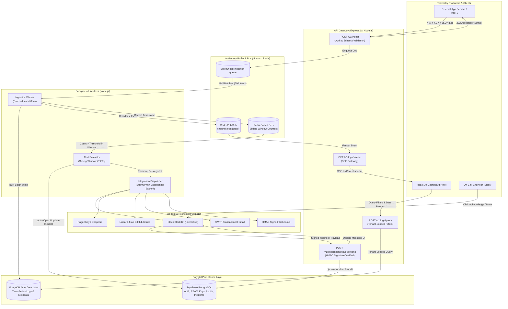

# LogLogic 🛰️

**An Enterprise-Grade B2B Observability & Incident Resolution Platform**

[](https://react.dev/)
[](https://vitejs.dev/)
[](https://tailwindcss.com/)
[](https://nodejs.org/)
[](https://expressjs.com/)
[](https://www.mongodb.com/)
[](https://redis.io/)
[](https://supabase.com/)
[](https://vercel.com/)
[](https://render.com/)
[](https://opensource.org/licenses/MIT)

---

### 🌐 Live Deployments

| Component | Service | URL | Notes |
|---|---|---|---|
| **Web Dashboard** | Vercel | [https://loglogic-frontend.vercel.app](https://loglogic-frontend.vercel.app) | Single Page Application with Client Routing |
| **API Gateway** | Render | [https://loglogic-backend.onrender.com](https://loglogic-backend.onrender.com) | Free-tier instance; initial spin-up takes ~50s |

> [!NOTE]
> The backend API is hosted on Render's free tier. If the service has spun down due to inactivity, the initial API call or health check may take ~45–60 seconds to cold-start. Once warm, all ingestion endpoints respond in under 20ms.

---

## 📖 Executive Summary & Problem Statement

Modern microservice and serverless architectures generate immense volumes of telemetry data. A single checkout transaction might traverse API gateways, auth microservices, payment orchestrators, inventory databases, and webhook listeners. When an incident occurs in production, software engineering and DevOps teams suffer from **fragmented observability**: engineers are forced to authenticate into disparate dashboards, SSH into container hosts, or comb through unstructured database dumps to track down error traces.

Simultaneously, traditional log management solutions suffer from two fatal flaws:
1. **The Ingestion Bottleneck:** During flash-crowd events or catastrophic cascading failures (e.g., Black Friday traffic or third-party API outages), synchronous logging pipelines overwhelm database connection pools and crash the logging infrastructure itself.
2. **Alert Fatigue & Stale Dashboards:** Polling-based dashboards introduce 5–30 second latency spikes, while naive alert rules blast notification channels without sliding-window deduplication, actionable context, or interactive triage.

**LogLogic** was architected to eliminate these failure modes. Built as an enterprise-grade "digital flight recorder," LogLogic acts as an **indestructible ingestion funnel and automated incident resolution platform**. By separating high-velocity ingestion from persistent storage using a resilient in-memory buffer, LogLogic acknowledges telemetry payloads in sub-20ms, visualizes logs live via Server-Sent Events (SSE) with sub-second latency, and coordinates multi-channel incident response with interactive ChatOps.

---

## 🏗️ System Architecture & Data Flow

LogLogic employs a **polyglot persistence model** and an event-driven, decoupled pipeline designed for extreme availability and multi-tenant isolation.



---

## ✨ Core Engineering Pillars

### 1. The "Shock Absorber" — High-Velocity Ingestion Pipeline
* **Sub-20ms 202 Accepted Response:** Incoming requests to `POST /v1/ingest` bypass immediate database writes. The gateway performs in-memory API key validation (comparing the SHA-256 hash of the `X-API-KEY` against PostgreSQL) and validates the payload schema with Joi (`service`, `level`, `message`, `metadata`). Once validated, the payload is enqueued into BullMQ (`log-ingestion-queue`) and returns an HTTP `202 Accepted` status within 15–20ms.
* **Batch Draining & Backpressure Immunity:** A dedicated, detached background worker (`ingestion.worker.js`) drains jobs from Redis in optimized chunks of up to 500 items, executing high-throughput batch writes to MongoDB Atlas using `insertMany()`. Even during massive Black Friday traffic surges, the Node.js event loop remains unblocked and MongoDB write operations remain linear and predictable.

### 2. The "Security Camera" — Sub-Second Live-Tailing via SSE
* **Event-Driven Pub/Sub Streaming:** Rather than hammering the database lake with polling intervals, LogLogic features a real-time Server-Sent Events (SSE) gateway at `GET /v1/logs/stream`. As the ingestion worker processes batches, it concurrently fans out logs to Redis Pub/Sub channels (`channel:logs:${orgId}`) with zero added write latency.
* **Resilient Client Streaming:** The browser establishes an authenticated `EventSource` connection. The SSE gateway transmits periodic 15-second heartbeat pings (`:keep-alive\n\n`) to prevent reverse-proxy timeouts.
* **Memory-Safe Terminal UI:** The frontend maintains a capped sliding-window ring buffer (max 1,000 logs in state) to eliminate browser memory leaks during bursts. Engineers can pause/resume the feed, toggle auto-scroll locking, filter by service or log level (`FATAL`, `ERROR`, `WARN`, `INFO`), apply regex filters, and inspect formatted JSON metadata in an inline collapsible tree view.

### 3. The "Bank Vault" — Cryptographic Multi-Tenant Isolation
* **Zero-Leak Data Isolation:** All MongoDB and PostgreSQL queries strictly enforce organization boundaries (`orgId = req.orgId`). Row-Level Security (RLS) policies in PostgreSQL safeguard tenant state.
* **One-Way Hashed API Keys:** API keys (`ll_prod_...`) are cryptographically generated using native `crypto.randomBytes(32)` and shown to the user exactly once. The backend stores exclusively the SHA-256 hash along with a safe, truncated hint (`ll_prod_...a8f2`) for identification and revocation.
* **AES-256-GCM Secret Encryption:** Integration provider secrets (Slack webhooks, PagerDuty routing keys, Linear tokens) are encrypted at rest using AES-256-GCM (`secretCrypto.js`) with an authenticated integrity tag, backed by an environment-isolated `INTEGRATION_ENCRYPTION_KEY`.

### 4. The "Virtual Office" — 5-Tier RBAC & Access Lifecycle
* **Granular Role Hierarchy:** Supports five distinct organizational roles: `owner`, `admin`, `developer`, `viewer`, and `auditor`. Access control is governed by an explicit permission matrix (`can_view_logs`, `can_export_logs`, `can_manage_keys`, `can_edit_billing`, `can_view_audit_trail`, `can_manage_members`, `can_manage_integrations`, `can_manage_alerts`) enforced via `requirePermission` middleware.
* **Contractor Access with Automatic Expiry:** Workspace owners can invite external contractors with an explicit `access_expires_at` timestamp. Middleware checks expiration on every request and gracefully blocks access once the deadline passes.
* **Self-Service Access Lifecycle:** Expired or removed team members can submit formal access extension requests from an interceptor screen. Owners and admins can approve or decline requests with custom durations.
* **Atomic Ownership Transfer:** Workspace owners can transfer complete organization ownership to any existing member in a single transaction, automatically demoting themselves to `admin`.
* **Transactional SMTP Notifications:** High-urgency branded HTML emails notify team members of access requests, approvals, rejections, expiries, and ownership changes.

### 5. Automated Incident Resolution & Sliding-Window Alerting
* **Sliding-Window Redis Sorted Sets:** Error frequency evaluation avoids expensive full-table database scans by leveraging Redis Sorted Sets (`ZADD org:{orgId}:alerts:{ruleId} <timestamp> <logId>`). The engine evaluates error spikes within sliding windows (e.g., `>5 ERROR logs in 5 minutes`) using $O(\log N)$ Redis operations (`ZREMRANGEBYSCORE` and `ZCARD`).
* **Incident Deduplication & Chronological Timeline:** When an alert rule fires, LogLogic checks for existing active incidents. New alerts are deduplicated and appended to an interactive chronological timeline containing trigger metrics, log excerpts, status changes (`triggered` → `acknowledged` → `resolved`), and triage notes.
* **Signature-Verified Slack Interactivity (Block Kit):** Dispatched Slack notifications include interactive "Acknowledge" and "Mute for 1hr" buttons. Slack button clicks route to `POST /v1/integrations/slack/actions`, where LogLogic verifies the raw request payload against the `SLACK_SIGNING_SECRET` using HMAC-SHA256, updates the incident timeline in PostgreSQL, and instantly rewrites the Slack message UI in real-time.
* **Omnichannel Ecosystem:** Native webhook adapters for PagerDuty (Events API v2), Opsgenie (P1/P2 priority mapping), Discord, Microsoft Teams, incident.io, and HMAC-SHA256 signed custom outgoing webhooks (`X-LogLogic-Signature`).
* **One-Click Issue Creation:** Engineers can escalate an error directly from the log details drawer into Linear, Jira, or GitHub Issues with pre-filled stack traces, metadata, and deep links.

### 6. The Immutable Security Audit Ledger
* **Tamper-Evident Append-Only Log:** Enterprise compliance requires an unalterable history of sensitive actions. LogLogic stores security events in a dedicated PostgreSQL `audit_logs` table protected by a `BEFORE UPDATE` database trigger that strictly raises an exception on any modification or deletion attempt.
* **Forensic Event Capture:** Records the actor ID, actor email, action type (e.g., `api_key.created`, `member.role_changed`, `logs.exported`, `auth.login`), target entity, client IP address (`TRUST_PROXY`-aware), User-Agent header, request ID, and a JSONB before/after state diff.
* **Auditor Console:** Security officers and administrators have access to an Audit Log console featuring action-type filters, pagination, and one-click CSV report exports for SOC 2 / ISO 27001 readiness.

---

## ⚖️ Architectural Decisions & Trade-Offs

| Decision | Chosen Solution | Alternative Evaluated | Trade-Off Rationale |
|---|---|---|---|
| **Storage Architecture** | Polyglot (PostgreSQL + MongoDB Atlas + Redis) | Single PostgreSQL or Single MongoDB | Relational DBs excel at strict constraints, transactions, and RBAC but degrade under massive append-only unstructured telemetry. MongoDB excels at schema-flexible JSON logs and text queries. Redis provides sub-millisecond queuing and atomic sliding-window arithmetic. |
| **Ingestion Write Path** | Asynchronous Buffer (`202 Accepted` via BullMQ) | Synchronous MongoDB `insertOne()` | Synchronous database writes tie HTTP response latency directly to database load. A sudden 10x traffic spike risks exhausting Node.js sockets. Queuing in Redis decouples ingestion speed from storage write speed. |
| **Live-Tailing Gateway** | Server-Sent Events (SSE) via `EventSource` | Bidirectional WebSockets (Socket.io) | Live log streaming is fundamentally unidirectional (server to client). SSE operates natively over standard HTTP/2, supports built-in reconnection protocols, handles corporate firewalls effortlessly, and eliminates the memory overhead of maintaining heavy WebSocket state machines. |
| **Alert Frequency Evaluation** | Redis Sorted Sets (ZSET) | Periodic SQL `SELECT COUNT(*)` crons | Running periodic SQL aggregate counts over millions of historical records introduces severe database I/O bottlenecks. Redis ZSETs allow O(log N) element insertion and expiration, enabling sub-millisecond evaluation at zero database cost. |
| **Audit Ledger Security** | PostgreSQL `BEFORE UPDATE` Trigger | Application-Level ORM Hooks | Application-level checks can be accidentally bypassed during direct database queries or migration scripts. A database-level trigger guarantees tamper-evident immutability regardless of how the database is accessed. |

---

## 🛠️ Complete Tech Stack

```
LogLogic Platform
├── Frontend (Client Dashboard)
│   ├── Framework: React 19 + Vite 8
│   ├── Routing: React Router 7
│   ├── Styling: TailwindCSS 4
│   ├── State & HTTP: Axios, Custom Hooks, Server-Sent Events (EventSource)
│   ├── Data Visualization: Recharts
│   └── Authentication: @supabase/supabase-js (OAuth & JWTs)
│
├── Backend (API Gateway & Processing Engine)
│   ├── Runtime: Node.js (v18+) + Express.js 5
│   ├── Validation: Joi Schema Validator
│   ├── Background Queues: BullMQ + IORedis
│   ├── Structured Logging: Pino
│   └── Cryptography: Native crypto (AES-256-GCM, SHA-256, HMAC-SHA256)
│
├── Persistence & Infrastructure
│   ├── Relational Core: Supabase (PostgreSQL with RLS & Triggers)
│   ├── Ingestion Buffer: Upstash Redis / Local Redis
│   ├── Data Lake: MongoDB Atlas (Mongoose with Compound Indexes)
│   ├── Deployment: Vercel (Frontend SPA) + Render (Backend Web Service & Workers)
│   └── External Integrations: Slack Block Kit, PagerDuty, Opsgenie, Linear, Jira, GitHub
```

---

## 📁 Repository Structure

```
Loglogic/
├── Loglogic-Frontend-/               # React 19 Single Page Application
│   ├── src/
│   │   ├── api/                      # Modular Axios clients with fallback logic
│   │   │   ├── access.js             # Access request lifecycle
│   │   │   ├── alerts.js             # Alert rules & incident triggers
│   │   │   ├── apiKey.js             # Key generation & revocation
│   │   │   ├── audit.js              # Audit log querying & CSV export
│   │   │   ├── billing.js            # Stripe checkout & subscription state
│   │   │   ├── integrations.js       # Slack, PagerDuty, Linear providers
│   │   │   ├── logs.js               # Historical MongoDB log querying
│   │   │   ├── organization.js       # Workspace switching & creation
│   │   │   └── team.js               # Member invites & role management
│   │   ├── components/               # UI components, modals, shell layout
│   │   ├── context/                  # AuthContext, OrgContext, ThemeContext
│   │   ├── lib/                      # Supabase client & permission helpers
│   │   └── pages/                    # Dashboard, LiveTail, HistoricalLogs, Alerts, Settings
│   ├── vercel.json                   # Single-page application route rewrites
│   └── package.json
│
├── Loglogic-Backend-/                # Node.js / Express API & Background Workers
│   ├── sql/                          # Supabase PostgreSQL schema migrations
│   │   ├── access_management.sql     # Access requests, temporary expirations, activity ledger
│   │   ├── advanced_queries.sql      # Saved queries & metadata search indexes
│   │   ├── alerting_system.sql       # Alert rules, incident history, sliding-window state
│   │   ├── audit.sql                 # Immutable audit logs & tamper-evident trigger
│   │   ├── billing.sql               # Subscription tiers, quotas, Stripe references
│   │   ├── integrations.sql          # Provider credentials (encrypted) & Slack configs
│   │   ├── rbac.sql                  # Granular permissions & role definitions
│   │   └── retention_audit.sql       # TTL log lifecycle & retention policies
│   ├── src/
│   │   ├── config/                   # Database connectors (Mongo, Redis, Supabase)
│   │   ├── controllers/              # Ingest, stream, query, auth, integrations controllers
│   │   ├── middlewares/              # requireAuth, validateApiKey, requireRole, requirePermission
│   │   ├── models/                   # MongoDB Mongoose schemas (Log, SavedQuery)
│   │   ├── queues/                   # BullMQ queue instantiations (logQueue, integrationQueue)
│   │   ├── utils/                    # secretCrypto (AES-256-GCM), audit logger, mailer
│   │   ├── workers/                  # ingestion.worker.js, integration.worker.js
│   │   └── server.js                 # Server entry point, route definitions, graceful shutdown
│   └── package.json
```

---

## 🚀 Getting Started (Local Development)

### Prerequisites
* **Node.js**: v18.0.0 or higher
* **Redis**: Local instance via Docker (`docker run -p 6379:6379 redis:alpine`) or an [Upstash](https://upstash.com/) instance
* **MongoDB**: Local MongoDB or free [MongoDB Atlas](https://www.mongodb.com/atlas) cluster
* **Supabase**: A free [Supabase](https://supabase.com/) project (PostgreSQL + Auth)
* *(Optional)* A Slack App with Incoming Webhooks & Interactivity enabled

---

### Step 1: Clone the Repository

```bash
git clone https://github.com/yourusername/loglogic.git
cd loglogic
```

---

### Step 2: Database Provisioning (Supabase PostgreSQL)

Open the **SQL Editor** in your Supabase dashboard and execute the migration files located in `Loglogic-Backend-/sql/` in the following sequence:

1. `rbac.sql` — Provisions role enumerations and permission tables.
2. `access_management.sql` — Provisions access requests, temporary memberships, and workspace activity.
3. `alerting_system.sql` — Provisions alert rules and incident history.
4. `integrations.sql` — Provisions encrypted integration configs and delivery tracking.
5. `audit.sql` — Provisions the append-only `audit_logs` table and immutability trigger.
6. `billing.sql` — Provisions subscription tiers and usage metering tables.

---

### Step 3: Backend Setup

```bash
cd Loglogic-Backend-
npm install
cp .env.example .env
```

Configure your `Loglogic-Backend-/.env` file:

```ini
PORT=5000
NODE_ENV=development

# Origins for CORS and magic invite links
FRONTEND_LOCAL_URL=http://localhost:5173
FRONTEND_DEPLOYED_URL=https://loglogic-frontend.vercel.app
CLIENT_URL=http://localhost:5173

# Supabase (PostgreSQL + Auth)
SUPABASE_URL=https://xxxxxxxxxxxx.supabase.co
SUPABASE_SERVICE_ROLE_KEY=eyJh... # Admin Service Role Key (Keep Private)

# MongoDB (Data Lake)
MONGODB_URI=mongodb+srv://<user>:<password>@cluster.mongodb.net/loglogic?retryWrites=true&w=majority

# Redis (BullMQ & Pub/Sub)
REDIS_URL=redis://127.0.0.1:6379
# For Upstash TLS: rediss://default:<password>@<host>:6379

# Worker Concurrency Tuning
WORKER_CONCURRENCY=5
INTEGRATION_WORKER_CONCURRENCY=5

# AES-256-GCM Key for encrypting integration credentials (32-byte hex string)
# Generate with: openssl rand -hex 32
INTEGRATION_ENCRYPTION_KEY=0123456789abcdef0123456789abcdef0123456789abcdef0123456789abcdef

# Slack Interactivity Signing Secret (Optional for local testing)
SLACK_SIGNING_SECRET=your_slack_signing_secret_here

# BullMQ Queue Monitor Dashboard (Mounted at /admin/queues)
BULL_BOARD_USER=admin
BULL_BOARD_PASSWORD=supersecret

# Transactional Email (Optional - console logs link if omitted)
SMTP_HOST=smtp.mailgun.org
SMTP_PORT=587
SMTP_USER=postmaster@loglogic.io
SMTP_PASS=password
SMTP_FROM=LogLogic <no-reply@loglogic.io>
```

Start the backend API and background workers:

```bash
npm run dev
```
*API Gateway starts on `http://localhost:5000`.*  
*Bull-Board dashboard is accessible at `http://localhost:5000/admin/queues`.*

---

### Step 4: Frontend Setup

Open a new terminal window:

```bash
cd Loglogic-Frontend-
npm install
cp .env.local.example .env.local   # or edit .env.local directly
```

Configure your `Loglogic-Frontend-/.env.local` file:

```ini
# Supabase Client Authentication (Public Anon Key)
VITE_SUPABASE_URL=https://xxxxxxxxxxxx.supabase.co
VITE_SUPABASE_ANON_KEY=eyJhbGciOiJIUzI1NiIsInR5cCI6IkpXVCJ9...

# Backend API Endpoints
VITE_API_LOCAL_URL=http://localhost:5000
VITE_API_DEPLOYED_URL=https://loglogic-backend.onrender.com
```

Start the Vite development server:

```bash
npm run dev
```
*Frontend opens at `http://localhost:5173`.*

---

## 🧪 Testing the Ingestion Pipeline

Once your backend is running and an organization has been created:

1. Navigate to **Settings → API Keys** on the dashboard.
2. Click **"Generate API Key"** and copy the raw key (e.g., `ll_prod_9f8e7d6c5b4a3...`).
3. Send a test log payload using `curl`:

```bash
curl -X POST http://localhost:5000/v1/ingest \
  -H "Content-Type: application/json" \
  -H "X-API-KEY: ll_prod_your_api_key_here" \
  -d '{
    "service": "payment-gateway",
    "level": "ERROR",
    "message": "Stripe webhook signature verification failed for invoice.payment_failed",
    "metadata": {
      "customerId": "cus_994821",
      "attempt": 3,
      "region": "us-east-1",
      "httpStatus": 400
    }
  }'
```

**Expected Response (in < 20ms):**
```json
{
  "status": "success",
  "message": "Log accepted for processing",
  "jobId": "12"
}
```

4. Watch the log appear live on the **Live Tail** screen (`/app/live-tail`) in real-time via Server-Sent Events without refreshing the page!

---

## 🗺️ Engineering Roadmap

- [x] **Phase 1–8: Foundational SaaS Architecture** (Polyglot model, SHA-256 API keys, 202-Accepted BullMQ buffer, MongoDB time-series data lake, and 5-tab self-service access lifecycle).
- [x] **Phase 9: Real-Time Live-Tailing** (Server-Sent Events gateway, Redis Pub/Sub broadcast, sliding-window ring buffer, and terminal UI).
- [x] **Phase 14: Incident Workflows & ChatOps** (Interactive Slack Block Kit with HMAC-SHA256 verification, PagerDuty Events API v2, Opsgenie priority mapping, and chronological incident timelines).
- [x] **Phase 15: Compliance & Security Ledger** (Granular 5-tier RBAC matrix, immutable PostgreSQL audit log with `BEFORE UPDATE` tamper-evident trigger, and CSV exports).
- [ ] **Phase 15+ (Enterprise Security):** Automated ingestion-time PII redaction engine (masking credit cards, social security numbers, and bearer tokens before persistence).
- [ ] **Phase 16 (Scale & Partitioning):** Migrating ingestion buffer to Apache Kafka for multi-region topic partitioning and MongoDB sharding strategy (`{ orgId: "hashed", timestamp: 1 }`).
- [ ] **Phase 17 (Developer Experience):** Publishing official `@loglogic/node`, `loglogic-python`, and `loglogic-go` lightweight buffering SDKs, alongside the `ll` CLI tool.
- [ ] **Phase 18 (AI Observability):** Statistical anomaly detection (Z-score baselines), Drain log template clustering (reducing dashboard noise by 95%), and LLM-assisted root-cause diagnosis.

---

## 🤝 Contributing

Contributions, bug reports, and architectural proposals are welcome. Please adhere to the following workflow:

1. Fork the Project.
2. Create your Feature Branch (`git checkout -b feature/AmazingFeature`).
3. Commit your Changes (`git commit -m 'feat: Add sliding-window rate limiter'`).
4. Push to the Branch (`git push origin feature/AmazingFeature`).
5. Open a Pull Request.

---

## 📝 License

Distributed under the **MIT License**. See [`LICENSE`](LICENSE) for more information.

---

<div align="center">
  <sub>Built with high-throughput precision by the Abhay3333.</sub>
</div>
